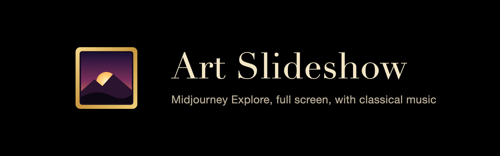

# Art Slideshow

A Chrome extension that plays the [Midjourney Explore](https://www.midjourney.com/explore?tab=top) page as a full-screen slideshow.

- Each image stays on screen for 30 seconds. ↑ / ↓ change that by 1 second per tap.
- Optional classical music: about 24 hours of public-domain recordings, shuffled by work, looping. Music is off by default; press M to turn it on.
- The window opens full screen, with no tabs or address bar.
- Images are never cropped. Empty space around them is pure black.
- Images fade slowly into each other.
- About 650 images: the 200 on Explore, plus the public gallery of every creator on Explore (their profile page). Explore images play first, then the galleries, mixed creator by creator. Videos are left out.
- The show loops. It re-reads Explore and the galleries every 10 minutes, so new images appear on their own.

## Why it is an extension

Midjourney's Cloudflare protection blocks other websites and servers from reading Explore. The extension runs inside your own Chrome, on midjourney.com, with your own session. Nothing is sent anywhere else.

## Install

1. Download this repository: click **Code → Download ZIP** and unzip it, or run `git clone https://github.com/guysopher/art-slideshow.git`.
2. In Chrome, open `chrome://extensions`.
3. Turn on **Developer mode** (top right).
4. Click **Load unpacked** and choose the unzipped folder. You can also drag the folder onto the page.
5. Optional: pin **Art Slideshow** from the puzzle-piece menu so its icon stays in the toolbar.

You need midjourney.com to open normally in that Chrome. If Cloudflare shows a "Just a moment" check, the slideshow starts after the check passes.

## Use

Click the **Art Slideshow** icon in the toolbar. A full-screen window opens and the show starts with music off. Press M to turn it on.

| Key | Action |
| --- | --- |
| → , Enter | Next image |
| ← | Previous image |
| Space | Pause / play the slideshow |
| ↑ / ↓ | 1 second slower / faster per tap (3 s to 600 s, remembered) |
| M | Music on/off for this show (off again on the next launch) |
| N | Next music piece |
| Alt+Shift+M | Music on/off from any Chrome window |
| Alt+Shift+N | Next music piece from any Chrome window |
| F | Page full screen on/off |

A short label at the bottom shows the new time, the pause state or the music state, then fades out.

Alt+Shift+M / Alt+Shift+N work while a slideshow window is open, even when another Chrome window is in front. Change them, or make them work in every app, at `chrome://extensions/shortcuts`.

To stop, close the window (⌘W on Mac, Ctrl+W on Windows). The mouse pointer hides after 1.5 seconds without movement.

## Update

After pulling new code, open `chrome://extensions` and click the reload arrow on the **Art Slideshow** card.

## Music

The music comes from [Musopen](https://musopen.org) recordings on archive.org ([MusopenCollectionAsFlac](https://archive.org/details/MusopenCollectionAsFlac), [musopen-chopin](https://archive.org/details/musopen-chopin)), all public domain. [`playlist.json`](playlist.json) lists 46 works (248 tracks): Beethoven, Mozart, Bach, Brahms, Tchaikovsky, Dvořák, Grieg, Chopin and more. Works play whole and in order; the order of works is shuffled each cycle. A track that fails to load is skipped.

## Settings

The constants at the top of [`slideshow.js`](slideshow.js) control the show:

| Constant | Default | Meaning |
| --- | --- | --- |
| `SHOW_MS` | `30000` | Default time per image, in milliseconds (↑ / ↓ override it) |
| `MIN_MS` / `MAX_MS` | `3000` / `600000` | Limits for ↑ / ↓ |
| `FADE_AUTO` | `2.5` | Fade length between images, in seconds |
| `FADE_MANUAL` | `1` | Fade length after a key press, in seconds |
| `FEED` | `top_month` | Explore feed to read (`top_month` is the default Explore tab) |
| `PAGES` | `4` | Pages of 50 images to load (4 = up to 200 images; Midjourney shows no more without a login) |
| `GALLERIES` | `true` | Also show each Explore creator's public gallery (up to 50 images each) |
| `GALLERY_PARALLEL` | `8` | Galleries read at the same time |
| `REFRESH_MS` | `600000` | How often to re-read Explore, in milliseconds |

In [`offscreen.js`](offscreen.js): `VOLUME` (`0.5`) and `FADE_MS` (`3000`, music fade in/out).

Reload the extension after changing them.

## How it works

- `background.js`: the toolbar click opens Explore in a full-screen popup window (no browser bars). Each time that window loads a midjourney.com page, the extension injects the slideshow into it. Other tabs are left alone. Music starts only when turned on and stops when the window closes.
- `slideshow.js`: reads Explore's own feed (`/api/explore`) and each Explore creator's gallery (`/api/spotlight-feed`) with your session, then covers the page with a black overlay that shows the full-size images, two layers crossfading.
- `icons/`: the extension icon (`icon.svg`, rendered to PNG at 16–512 px) and the README banner.
- `offscreen.html` / `offscreen.js`: a hidden extension page that plays `playlist.json`, so the music keeps going while Midjourney pages reload.

If the feed fails three times in a row (for example, the session expired), the page reloads itself and the show restarts.

## Disclaimer

Not affiliated with Midjourney. The images belong to their creators. They are shown from Midjourney's own servers, as on the Explore page.
